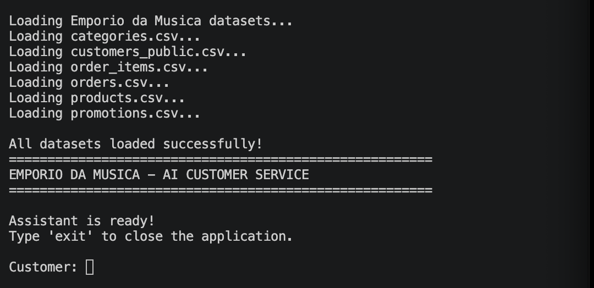
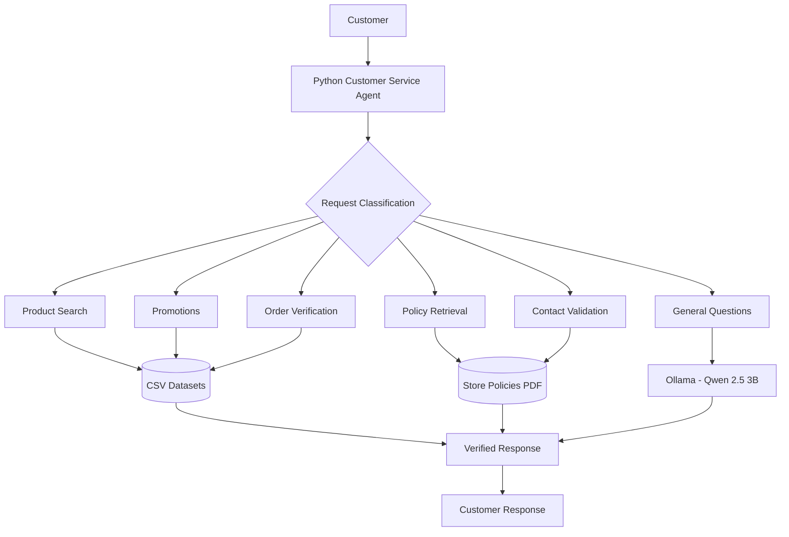

# 🎵 Empório da Música — AI Customer Service Agent


An AI-powered customer service assistant developed in Python, using a locally running Large Language Model (LLM) to automate customer interactions for a musical instrument store.

The application combines natural language processing, structured business data, product search, order verification and policy document retrieval.

## 📸 System Preview



*The application loading its datasets and initializing the AI customer service assistant.*

## 🚀 Features

- **AI Customer Service:** Natural language interactions powered by Qwen 2.5 3B.
- **Product Search:** Search musical instruments using structured CSV datasets.
- **Category Recognition:** Distinguishes acoustic guitars, electric guitars, basses, keyboards, ukuleles and drums.
- **Promotions:** Retrieves active promotions and product discounts.
- **Order Tracking:** Verifies order information using the order ID and registered customer email.
- **Policy Retrieval:** Searches the store's PDF policy document.
- **Business Hours:** Provides official store opening hours.
- **Contact Validation:** Detects conflicting contact information instead of providing unverified phone numbers.
- **Privacy Protection:** Avoids exposing unnecessary customer information.
- **Automated Testing:** Includes 21 unit tests covering important application behaviors.

## 🛠️ Technologies

| Technology | Purpose |
|---|---|
| Python | Main programming language |
| Ollama | Local LLM execution |
| Qwen 2.5 3B | Natural language understanding and generation |
| Pandas | Dataset processing and manipulation |
| PyMuPDF | PDF policy document extraction |
| CSV | Structured business data storage |
| Unittest | Automated testing |
| Git & GitHub | Version control and project hosting |

## 🧠 Architecture



## 📂 Project Structure

```text
emporio-da-musica-ai-agent/
│
├── screenshots/
│   └── 01-system-startup.png
│
├── emporio-da-musica-agent/
│   │
│   ├── data/
│   │   ├── categories.csv
│   │   ├── customers_public.csv
│   │   ├── order_items.csv
│   │   ├── orders.csv
│   │   ├── products.csv
│   │   ├── promotions.csv
│   │   └── store_policies.pdf
│   │
│   ├── examples/
│   │   └── conversations.md
│   │
│   ├── src/
│   │   ├── agent.py
│   │   ├── data_loader.py
│   │   ├── llm.py
│   │   ├── policies.py
│   │   └── tools.py
│   │
│   ├── tests/
│   │   └── test_agent.py
│   │
│   ├── main.py
│   └── requirements.txt
│
├── .gitignore
├── LICENSE
└── README.md
```

## ⚙️ Installation

### Prerequisites

- Python 3.10 or higher
- Ollama
- Git

### 1. Clone the repository

```bash
git clone https://github.com/lucasml10/emporio-da-musica-ai-agent.git

cd emporio-da-musica-ai-agent
```

### 2. Install Ollama

Download and install Ollama:

https://ollama.com/download

### 3. Download the AI model

```bash
ollama pull qwen2.5:3b
```

### 4. Navigate to the application directory

```bash
cd emporio-da-musica-agent
```

### 5. Create a virtual environment

```bash
python3 -m venv .venv
```

Activate it on macOS or Linux:

```bash
source .venv/bin/activate
```

On Windows:

```bash
.venv\Scripts\activate
```

### 6. Install dependencies

```bash
pip install -r requirements.txt
```

## ▶️ Running the Application

Make sure Ollama is running and the Qwen model is available.

From the `emporio-da-musica-agent` directory, execute:

```bash
python main.py
```

The application will load the datasets and initialize the customer service assistant.

Example:

```text
EMPORIO DA MUSICA - AI CUSTOMER SERVICE

Assistant is ready!
Type 'exit' to close the application.

Customer: What are your store opening hours?

Assistant:
Our official store opening hours are:

- Monday to Friday: 09:00 AM to 06:00 PM
- Saturday: 09:00 AM to 01:00 PM
- Sundays and holidays: Closed
```

## 🧪 Automated Tests

The project includes 21 automated unit tests.

Run the test suite:

```bash
python -m unittest discover -s tests -v
```

The tests cover:

- Product accessory restrictions.
- Product request classification.
- Generic price questions.
- Store contact validation.
- Conflicting phone number detection.
- Policy retrieval.
- Order verification requirements.
- Customer data protection.
- LLM connection error handling.
- Input validation.
- General AI response generation.

**Latest validation: 21 tests passed.**

## 🔒 Data Privacy and Reliability

The application implements several safeguards:

- Order verification requires an order ID and registered email.
- Unnecessary customer information is not included in order responses.
- Contact information is checked against the policy document.
- Conflicting phone numbers are not presented as verified information.
- Product availability and prices are retrieved from structured datasets.
- Policy answers are grounded in the store's PDF documentation.

## ⚠️ Current Scope and Limitations

- The application currently runs as a command-line interface.
- The language model runs locally through Ollama.
- Product and customer information depends on the supplied datasets.
- The application uses simulated business datasets for demonstration and development.
- It does not currently integrate with a live e-commerce platform or external order management system.

## 🔮 Future Improvements

- Develop a web-based customer service interface.
- Integrate a database for persistent business data.
- Add a REST API using FastAPI.
- Implement conversation history and customer context.
- Improve multilingual support.
- Integrate with external inventory and order management systems.

## 👨‍💻 Author

**Lucas Pereira de Melo Barbosa**

ADS Student | Python | Artificial Intelligence | Cybersecurity | IT Infrastructure

GitHub: https://github.com/lucasml10

LinkedIn: https://www.linkedin.com/in/lucasmelo-dev-ads

---

**Technologies:** Python · Ollama · Qwen 2.5 · Pandas · PyMuPDF · Git · GitHub
