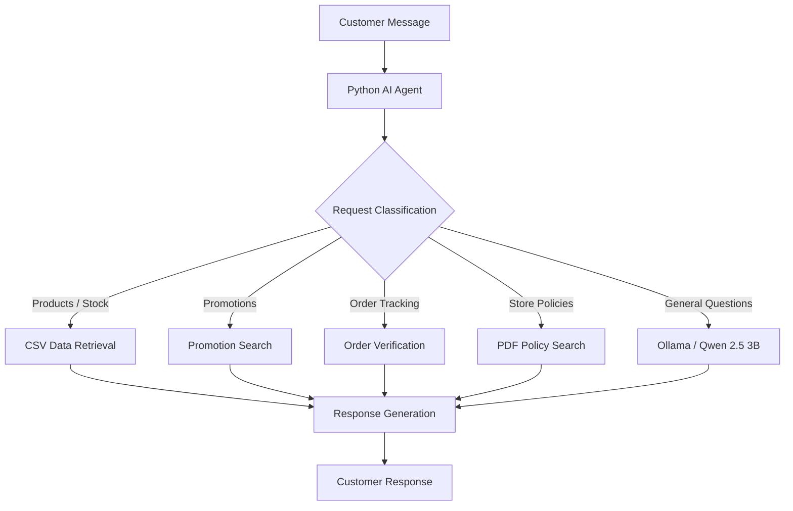

# 🎵 Empório da Música — AI Customer Service Agent


An AI-powered customer service agent developed in Python for a fictional musical instruments store in Campo Grande, Brazil.

The application processes customer messages in natural language and retrieves information from structured datasets, store policy documents, and a locally hosted language model.

The project combines deterministic business logic with Large Language Model (LLM) capabilities to deliver more controlled and context-aware customer interactions.

## 🚀 Key Features

- **Product Search:** Search musical instruments by name, category, and price.
- **Product Information:** Retrieve product descriptions, specifications, prices, and stock availability.
- **Promotions:** Identify and display active promotional offers.
- **Order Tracking:** Verify order status using an order ID and registered customer email.
- **Policy Retrieval:** Search store policies covering business hours, payments, exchanges, returns, shipping, and warranties.
- **Request Classification:** Route customer requests to the appropriate functionality.
- **Scope Control:** Handle requests involving products and services outside the store's scope.
- **Local AI Integration:** Use Qwen 2.5 3B through Ollama for general conversational responses.

## 🧰 Technology Stack

| Technology | Purpose |
|---|---|
| Python | Application logic and business rules |
| Ollama | Local LLM execution |
| Qwen 2.5 3B | Natural language generation |
| Pandas | Structured CSV data processing |
| PyMuPDF | PDF text extraction |
| Unittest | Automated testing |
| Git & GitHub | Version control and project management |

## 🏗️ System Architecture

The application follows a hybrid architecture combining deterministic request routing, structured data retrieval, document-based policy search, and LLM-generated responses.



### Architecture Components

1. **Request Routing:** Identifies the type of customer request and directs it to the appropriate Python functionality.
2. **Structured Data Retrieval:** Uses Pandas to query product, inventory, promotion, and order datasets.
3. **Policy Retrieval:** Extracts and searches relevant content from the store policy PDF using keyword-based matching.
4. **LLM Integration:** Sends general conversational requests to the locally running Qwen model through Ollama.
5. **Response Handling:** Returns customer-facing responses based on retrieved information or LLM generation.

**Design principle:** Business-critical information is retrieved through explicit Python logic rather than relying exclusively on model-generated answers.

## 📁 Project Structure

```text
emporio-da-musica-ai-agent/
│
├── emporio-da-musica-agent/
│   │
│   ├── data/
│   │   ├── categories.csv
│   │   ├── customers_public.csv
│   │   ├── order_items.csv
│   │   ├── orders.csv
│   │   ├── products.csv
│   │   ├── promotions.csv
│   │   └── store_policies.pdf
│   │
│   ├── examples/
│   │   └── conversations.md
│   │
│   ├── src/
│   │   ├── agent.py
│   │   ├── data_loader.py
│   │   ├── llm.py
│   │   ├── policies.py
│   │   └── tools.py
│   │
│   ├── tests/
│   │   └── test_agent.py
│   │
│   ├── main.py
│   └── requirements.txt
│
├── .gitignore
├── LICENSE
└── README.md
```

## ⚙️ Installation and Setup

### Prerequisites

- Python 3.10 or newer
- [Ollama](https://ollama.com/) installed
- Qwen 2.5 3B model

### 1. Clone the repository

```bash
git clone https://github.com/lucasml10/emporio-da-musica-ai-agent.git
cd emporio-da-musica-ai-agent/emporio-da-musica-agent
```

### 2. Create a virtual environment

```bash
python3 -m venv .venv
```

**macOS / Linux:**

```bash
source .venv/bin/activate
```

**Windows PowerShell:**

```powershell
.venv\Scripts\Activate.ps1
```

### 3. Install dependencies

```bash
python -m pip install --upgrade pip
pip install -r requirements.txt
```

### 4. Download the language model

```bash
ollama pull qwen2.5:3b
```

Make sure the Ollama service is running before starting the application.

## ▶️ Running the Application

Start the interactive customer service agent:

```bash
python main.py
```

The application will open an interactive terminal session where customers can submit questions.

To close the application, type:

```text
exit
```

## 🧪 Automated Testing

Run the automated test suite:

```bash
python -m unittest discover -s tests -v
```

The current test suite contains **9 automated tests** covering:

- Accessory request detection and handling.
- Product-related request classification.
- Generic price clarification.
- Policy question identification.
- Order verification requirements.
- Language model routing and fallback behavior.

## 🔐 Data Privacy

Data privacy is an important consideration in this project.

- The public repository uses `customers_public.csv`, containing anonymized customer records for demonstration purposes.
- The original `customers.csv` file is excluded through `.gitignore`.
- Order verification requires an order ID and registered customer email.
- The datasets are static demonstration fixtures and do not represent a live store database.

## ⚠️ Current Limitations

- Product, inventory, order, and promotion information relies on static CSV datasets.
- Policy retrieval uses keyword-based matching rather than semantic vector search.
- General conversational responses depend on the locally running Qwen model.
- The interface is currently command-line based.
- There are no integrations with real payment, inventory, or shipping providers.
- Ambiguous policy cases may require human review.

## 🔮 Future Improvements

- Implement semantic document retrieval using embeddings and a vector database.
- Develop a web-based customer service interface.
- Integrate a persistent database.
- Improve automated intent classification.
- Add conversation history and session management.
- Implement human handoff for complex customer requests.
- Expand automated and integration testing.

## 👨‍💻 Development Approach

This project was developed as part of a technical challenge for an AI Engineer role.

AI-assisted development tools were used during implementation, debugging, and documentation. Architecture decisions, code integration, and testing were reviewed throughout development.

The project demonstrates practical knowledge of Python development, data processing, local LLM integration, document retrieval, software testing, and version control.

---

## 👤 Author

**Lucas Pereira de Melo Barbosa**

- GitHub: [@lucasml10](https://github.com/lucasml10)
- Project Repository: [Empório da Música AI Agent](https://github.com/lucasml10/emporio-da-musica-ai-agent)

**Technologies:** Python · Ollama · Qwen 2.5 · Pandas · PyMuPDF · Git · GitHub